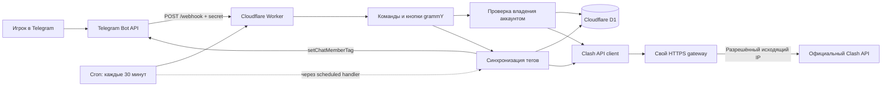

# Как устроен CoCClansBot

Начать чтение кода лучше с `src/index.ts`. Там две точки входа: Telegram webhook и Cron Cloudflare.

## Где менять поведение

| Задача | Файл |
| --- | --- |
| Проверка webhook и защита от повторной обработки | `src/index.ts`, `src/webhook.ts` |
| Тексты, привязка и кнопки игрока | `src/bot/player.ts`, `src/bot/menu.ts` |
| Настройка группы и команды администратора | `src/bot/admin.ts` |
| Проверка игрового токена и сохранение привязки | `src/services/linking.ts` |
| Порядок проверки участников и обновление тегов | `src/services/sync.ts` |
| Обращение к Clash API | `src/clients/clash.ts` |
| Запросы к базе, курсоры и блокировки | `src/db/store.ts` |
| Таблицы и индексы | `migrations/` |
| Параметры Workers, D1 и Cron | `wrangler.toml` |
| Выход к Clash API с постоянного IP | `gateway/server.ts` |

## Как проходит привязка

1. В личном чате игрок присылает Player Tag.
2. Бот читает профиль и показывает найденного игрока.
3. Игрок присылает API Token из настроек игры.
4. Бот пытается удалить сообщение и вызывает `verifytoken`.
5. При успешной проверке D1 сохраняет связь Telegram ID и Player Tag. Уникальный индекс не позволяет занять уже привязанный аккаунт.
6. Игровой токен не записывается в базу. Сервис синхронизации проверяет теги в подключённых группах.

## Как работает синхронизация

Cron выбирает просроченную партию игроков. Для каждого бот получает текущий ник, проверяет свои права и участие игрока в группе. Если живой тег уже совпадает, запись в Telegram не выполняется. При нехватке бюджета запросов позиция сохраняется в D1.

Ручной `/sync` работает только с текущей группой и использует отдельный курсор. Общая блокировка не даёт ручному запуску, Cron и настройке группы менять состояние одновременно.

## Открыть в VS Code

Откройте `CoCClansBot.code-workspace`, затем этот файл и его Markdown Preview (`Ctrl+Shift+V`). Задачи проверки, локального запуска и миграций находятся в меню **Terminal → Run Task**. Команда **Run Build Task** запускает `pnpm check`.

Без установленного редактора исходники можно открыть в [VS Code для браузера](https://github.dev/BozemenOfficial/CoCClansBot). Это редактор кода; для запуска команд нужен локальный Node.js или среда разработки с терминалом.

Порядок развёртывания и необходимые секреты описаны в [README](../README.md). Для постоянного запуска нужны аккаунт Cloudflare и доступ к Clash API с разрешённого исходящего IP.
