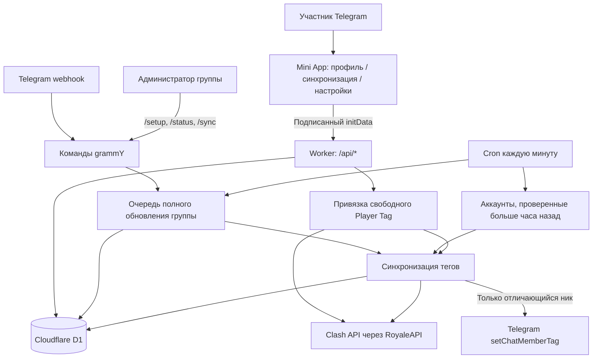

# Архитектура первой версии

## Где находится код

| Задача | Файл |
| --- | --- |
| Раздача приложения, webhook и планировщик | `src/index.ts` |
| Мобильный интерфейс без сборки | `public/app/index.html`, `style.css`, `app.js` |
| Проверка Telegram HMAC и срока launch data | `src/miniapp/auth.ts` |
| Личное API без выбора чужого пользователя | `src/miniapp/api.ts` |
| Кнопка открытия приложения и старые ссылки меню | `src/bot/player.ts` |
| Администраторские команды группы | `src/bot/admin.ts` |
| Проверка состава клана и занятости тега | `src/services/linking.ts`, `roster.ts` |
| Проверка Telegram-участия и изменение тега | `src/services/sync.ts` |
| Полный проход группы несколькими запусками | `src/services/sync-jobs.ts` |
| SQL, курсоры и блокировки | `src/db/store.ts` |
| Настройки Workers, D1, Assets и Cron | `wrangler.toml` |
| Установка меню приложения и webhook | `scripts/webhook.mjs` |

## Поток регистрации

1. Telegram открывает Mini App с подписанным `initData`.
2. Сервер проверяет подпись, срок и пользователя. Клиентское поле `initDataUnsafe` для авторизации не используется.
3. Участник вводит тег. Сервер проверяет, что профиль находится в подключённом клане, тег присутствует в полном составе, пользователь состоит в Telegram-группе этого клана и тег свободен.
4. D1 атомарно сохраняет привязку. Владение игровым аккаунтом не подтверждается.
5. Сразу запускается проверка тега этого пользователя. Если бот не имеет прав или Telegram временно недоступен, привязка остаётся сохранённой, а ошибка показывается в состоянии синхронизации.

## Как проходит обновление

Cron выбирает аккаунты с `sync_enabled=1`, срок проверки которых наступил. Успешно обработанный аккаунт откладывается на час. Бот читает игровой ник, проверяет клан, своё право управлять тегами и членство пользователя в группе. Администраторы Telegram пропускаются. Совпадающий тег не записывается повторно.

Принудительный `/sync` доступен только действующему неанонимному администратору группы. Задача в `sync_jobs` обходит всех активных привязанных участников через устойчивый курсор. Отключение синхронизации действует и на эту очередь.

Привязка, отвязка, изменение настройки, настройка группы и синхронизация используют общую аренду `sync`. Очередь дополнительно защищена арендой `sync-jobs`. Уже созданные привязки и исторические данные сохраняются миграциями; код модерации не подключён и не может менять права участников.

Для VS Code откройте `CoCClansBot.code-workspace`, затем Markdown Preview этого документа. Порядок запуска и команды — в [README](../README.md).
